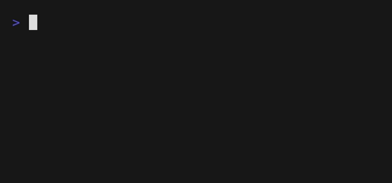

# Readability

# What to Do

Some books are written for young children, others for university students.
But what does it mean for a text to be at a particular reading level?

Well, in many cases, a human expert might read a book and make a decision on the grade (i.e., year in school) for which they think the book is most appropriate.
But an algorithm could likely figure that out too!

In a file called `readability.py`, write a Python program that calculates the approximate grade level needed to comprehend some text.
The text is stored in a file whose name is given on the command line.



Your program should print as output `Grade X` where `X` is the grade level computed, rounded to the nearest integer.
If the grade level is 16 or higher (equivalent to or greater than a senior undergraduate reading level), your program should output `Grade 16+` instead of giving the exact index number.
If the grade level is less than 1, your program should output `Before Grade 1`.

```bash
$ python readability.py genome.txt
Grade 16+
```

There must be exactly one command-line argument (the file name).
If not, the program should print `Usage: python readability.py filename` and stop.

```bash
$ python readability.py
Usage: python readability.py filename
$ python readability.py cells.txt genome.txt
Usage: python readability.py filename
```

## The Coleman-Liau index

So what sorts of traits are characteristic of higher reading levels? Well, longer words probably correlate with higher reading levels. Likewise, longer sentences probably correlate with higher reading levels, too.

A number of “readability tests” have been developed over the years that define formulas for computing the reading level of a text. One such readability test is the Coleman-Liau index. The Coleman-Liau index of a text is designed to output that (U.S.) grade level that is needed to understand some text. The formula is

```
index = 0.0588 * L - 0.296 * S - 15.8
```

- `L` is the average number of letters per 100 words in the text (`nb_letters * 100 / nb_words`)
- `S` is the average number of sentences per 100 words in the text (`nb_sentences * 100 / nb_words`).

The grade is `index` rounded to the nearest integer: if this grade is less than `1`, print `Before Grade 1`; if it is `16` or more, print `Grade 16+`.

> [!IMPORTANT]
> The Coleman-Liau formula was designed and calibrated with **English** texts only.
> French words, for instance, are longer on average than English words, so a French text gets a much higher grade than its real difficulty: the result means nothing.
> That is why all the texts of this exercise are in English.

## Letters, words and sentences

To get the same results as the tests, count as follows:

- a **letter** is a character for which the method `isalpha()` returns `True` (`a` to `z`, `A` to `Z`). Digits, spaces and punctuation marks are not letters.
- a **word** is a sequence of characters separated by spaces or newlines. Thus `self-conscious`, `you're` and `fish.` are one word each.
- a **sentence** ends with a `.`, a `!` or a `?`. Count one sentence for each of these characters.

> [!NOTE]
> It is an approximation: in `Mr. Smith is here.`, your program will count two sentences. That's fine, the formula is an approximation too.

For instance, the text `One fish. Two fish! Red fish? Blue fish.` has 29 letters, 8 words and 4 sentences, so:

- `L = 29 * 100 / 8 = 362.5`
- `S = 4 * 100 / 8 = 50.0`
- `index = 0.0588 * 362.5 - 0.296 * 50.0 - 15.8 = -9.285`, rounded to `-9`, so `Before Grade 1`.

> [!TIP]
> The command-line arguments are stored in the list `sys.argv` (after `import sys`).
> `sys.argv[0]` is the name of the script, so for `python readability.py cells.txt`, `sys.argv` is `['readability.py', 'cells.txt']`.
> To stop your program right away, you may use `sys.exit()`.

> [!TIP]
> The method `read()` returns the whole content of a file as one `str` (newlines included):
> ```python
> with open(filename) as text_file:
>     text = text_file.read()
> ```
> Then, the methods `isalpha()` and `split()` of `str`, and the function `round()` will help you. Read the Doc!
> What does `split()` return when two words are separated by a newline? And by two spaces?

# How to Test

Three text files are given for testing:

```bash
$ python readability.py cells.txt
Grade 3
$ python readability.py evolution.txt
Grade 12
$ python readability.py genome.txt
Grade 16+
```

Then test your program from the exercise folder with:

```bash
python test_readability.py
```

(use `python3` instead of `python` if that is how you run Python on your computer).

The script runs your program as a user would: it writes a text in a file, gives the name of this file to your program on the command line, then checks what your program prints.
When a test fails, it explains what is wrong and gives the expected numbers of letters, words and sentences, so that you can compare them with yours.
After all the tests, it tries to find the probable cause of the wrong results.

Don't forget it's important to test your program yourself too.
Copy each of these texts in a file and check the grade computed by your program:

`One fish. Two fish. Red fish. Blue fish.` (Before Grade 1)

`Would you like them here or there? I would not like them here or there. I would not like them anywhere.` (Grade 2)

`Congratulations! Today is your day. You're off to Great Places! You're off and away!` (Grade 3)

`In my younger and more vulnerable years my father gave me some advice that I've been turning over in my mind ever since.` (Grade 7)

`There are more things in Heaven and Earth, Horatio, than are dreamt of in your philosophy.` (Grade 9)

`It was a bright cold day in April, and the clocks were striking thirteen. Winston Smith, his chin nuzzled into his breast in an effort to escape the vile wind, slipped quickly through the glass doors of Victory Mansions, though not quickly enough to prevent a swirl of gritty dust from entering along with him.` (Grade 10)

`A large class of computational problems involve the determination of properties of graphs, digraphs, integers, arrays of integers, finite families of finite sets, boolean formulas and elements of other countable domains.` (Grade 16+)

What happens if:
* the text contains digits?
* the text is written on several lines?
* there are two spaces between two sentences?

# How to Submit

Once you're done with all tasks, submit all your python files for the week on Moodle.

# Licence

This course is freely inspired by [CS50’s Introduction to Computer Science](https://cs50.harvard.edu/x/2025/) Harvard. It is licensed under a [CC BY-NC-SA 4.0](https://creativecommons.org/licenses/by-nc-sa/4.0/) license.
